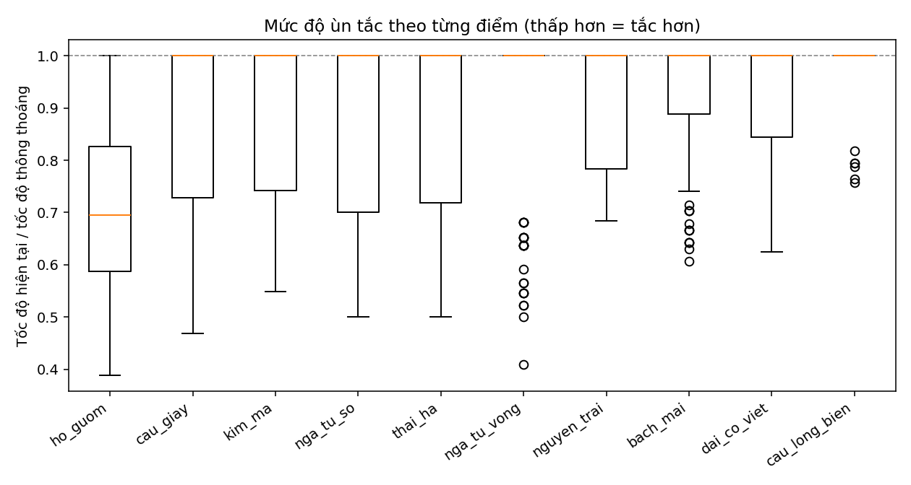
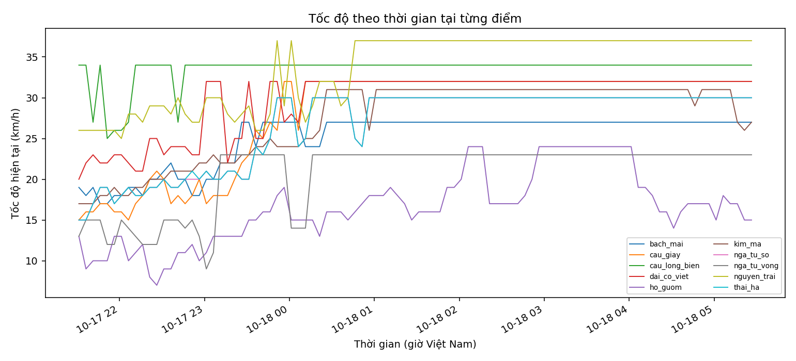
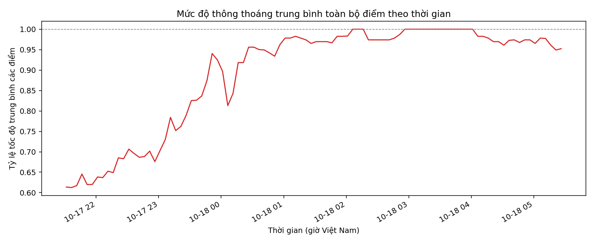
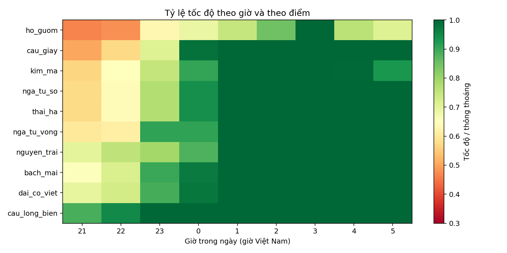
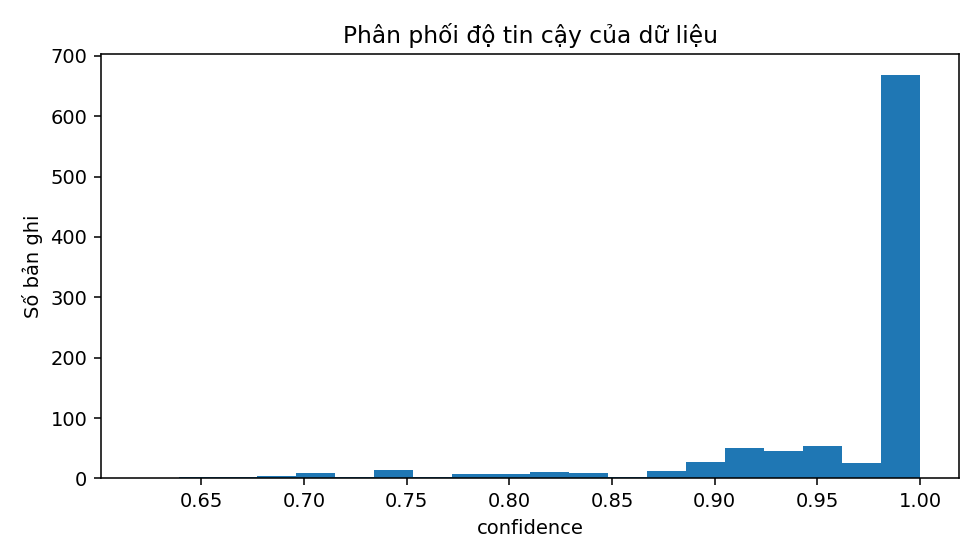
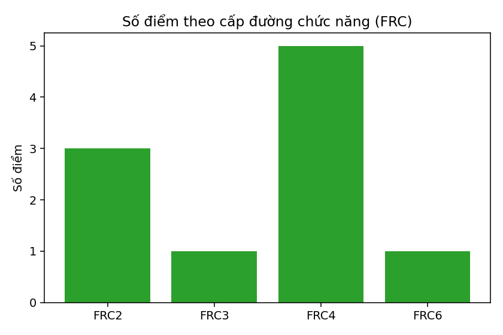

# Báo cáo dữ liệu giao thông Hà Nội thu thập từ TomTom Traffic API

> **Dữ liệu phân tích:** `data/traffic_20261017_1431.jsonl` – 960 bản ghi (10 điểm × 96 lượt), từ 21:31 ngày
> 17/10/2026 đến 05:26 ngày 18/10/2026 (giờ Việt Nam), tức một đêm cuối tuần.

## 1. Tổng quan

- **Mục tiêu:** thu thập chuỗi thời gian về tình trạng giao thông tại nhiều điểm của Hà Nội,
  phục vụ phân tích quy luật theo giờ/ngày và dự báo giao thông.
- **Nguồn dữ liệu:** TomTom Traffic API, dịch vụ *Traffic Flow – Flow Segment Data*.
- **Cách thu thập:** gọi API định kỳ cho một tập điểm cố định, mỗi lần gọi cho một bản ghi.
- **Định dạng lưu trữ:** JSON Lines (`.jsonl`), mỗi dòng là một bản ghi.

## 2. Nguồn dữ liệu và phương pháp thu thập

### 2.1. API sử dụng

```
GET https://api.tomtom.com/traffic/services/4/flowSegmentData/absolute/10/json
    ?key=<API_KEY>&point=<lat>,<lon>
```

- `point`: tọa độ `vĩ độ,kinh độ` (WGS84). Theo tài liệu TomTom, API trả về thông tin tốc độ và thời gian
  di chuyển của **đoạn đường gần tọa độ đó nhất**. API **không** làm việc với "khu vực" hay "ngã tư":
  mỗi lần gọi chỉ cho đúng một đoạn đường.
- `absolute`: kiểu hiển thị dùng chung với Flow Tiles; ảnh hưởng đến tọa độ trong phản hồi.
- `10`: mức zoom (0–22). Theo tài liệu, zoom ảnh hưởng đến độ lệch nhỏ của tọa độ đoạn đường và đến
  việc đường kém quan trọng có được "nhìn thấy" hay không (đường nhỏ chỉ xuất hiện ở zoom cao hơn).
- Đơn vị tốc độ mặc định là `km/h` (tham số `unit`, mặc định `kmph`).

Các trường trong phản hồi được đối chiếu với tài liệu chính thức:
<https://docs.tomtom.com/traffic-api/documentation/tomtom-maps/v1/traffic-flow/flow-segment-data>
(Flow Segment Data, phiên bản dịch vụ 4).

### 2.2. Các điểm lấy mẫu

**Điểm lấy mẫu khác với "khu vực".** Mỗi điểm là một tọa độ; API gắn nó vào đoạn đường gần nhất và chỉ
trả về dữ liệu của đoạn đường đó. Vì vậy:

- Để phân tích **một khu vực**, cần chọn **nhiều đường** thuộc khu vực đó và đặt điểm lên từng đường, rồi
  gộp kết quả theo nhãn khu vực (`area`).
- Điểm đặt **tại ngã tư** có thể bị gắn vào bất kỳ đường nào trong các đường giao nhau.
  Nên đặt điểm ở **giữa đoạn đường** thay vì sát nút giao.

Đợt crawl đầu tiên dùng 10 điểm do nhóm đặt tên theo địa danh và nút giao (tọa độ gần đúng, xác định thủ
công, **chưa kiểm chứng đường mà API thực sự gắn vào**):

| Điểm (tên nhóm đặt) | Vĩ độ | Kinh độ | Đường API thực sự gắn vào |
|---|---|---|---|
| ho_guom | 21.0285 | 105.8542 | Đường Trần Nhật Duật |
| nga_tu_so | 21.0072 | 105.8268 | Phố Thái Hà |
| cau_giay | 21.0333 | 105.7940 | Đường Cầu Giấy |
| nga_tu_vong | 20.9969 | 105.8409 | Đường Giải Phóng |
| kim_ma | 21.0330 | 105.8160 | Đường Văn Cao |
| thai_ha | 21.0110 | 105.8200 | Phố Thái Hà |
| dai_co_viet | 21.0050 | 105.8450 | Đường Trần Khát Chân |
| nguyen_trai | 20.9985 | 105.8010 | Đường Nguyễn Xiển (¹) |
| cau_long_bien | 21.0437 | 105.8590 | Đường Nguyễn Văn Cừ |
| bach_mai | 21.0000 | 105.8510 | Phố Lê Thanh Nghị |

Cột cuối lấy từ kết quả `python calibrate_points.py --input points_current.csv` (lưu ở
`points_current_calibrated.csv`): script gọi TomTom Reverse Geocoding tại điểm giữa danh sách tọa độ của
đoạn đường mà Flow Segment Data trả về, rồi đổi thành tên đường.

(¹) TomTom trả về "Đường Nguyễn Xiến" (xem `points_current_calibrated.csv`). Đây nhiều khả năng là lỗi chính tả trong dữ liệu
bản đồ; tên đường thực tế là Nguyễn Xiển.

**Nhận xét từ kết quả kiểm chứng:**

- Chỉ **3/10 điểm** nằm trên đường mà tên điểm gợi ra: `cau_giay` (Đường Cầu Giấy), `nga_tu_vong`
  (Đường Giải Phóng, một trong các đường tại nút Ngã Tư Vọng) và `thai_ha` (Phố Thái Hà).
- 7 điểm còn lại bị gắn vào đường khác, thường là đường lân cận (ví dụ `kim_ma` → Đường Văn Cao,
  `bach_mai` → Phố Lê Thanh Nghị, `ho_guom` → Đường Trần Nhật Duật). Vì vậy **tên điểm trong dữ liệu chỉ là
  nhãn nội bộ**; khi diễn giải kết quả cần dùng tên đường ở cột cuối.
- `nga_tu_so` và `thai_ha` cùng gắn vào **Phố Thái Hà** (cùng một đoạn đường).
- Tên đường là kết quả đổi tại điểm giữa của danh sách tọa độ. Đoạn đường dài (tới hơn 7 km) có thể đi qua
  nhiều đường, và tọa độ bị dịch nhẹ khỏi đường thật, nên tên này chỉ mang tính nhận diện gần đúng.

Phiên bản hiện tại của quy trình thu thập chọn điểm **theo tên đường**: `candidates.csv` liệt kê các
trục đường, `calibrate_points.py` tìm tọa độ bằng TomTom Geocoding, kiểm tra tên đường mà API trả về và
loại điểm trùng; kết quả lưu ở `points.json` để `crawl.py` dùng.

### 2.3. Chu kỳ và hạn mức

- Chu kỳ thu thập: **5 phút/lượt**, mỗi lượt gọi lần lượt 10 điểm (cách nhau 0,3 giây).
- Đợt crawl chính: chạy liên tục khoảng **8 giờ** (từ 21:31 tối thứ Bảy 17/10 đến 05:26 sáng Chủ Nhật
  18/10/2026) trên Kaggle Notebook (CPU), tương đương 96 lượt × 10 điểm = **960 request**. Dữ liệu nằm ở
  `data/traffic_20261017_1431.jsonl` (tên file theo giờ UTC lúc bắt đầu).
- Gói miễn phí của TomTom cho 2.500 request không phải tile mỗi ngày; script tự giới hạn ở
  2.000 request/ngày để có biên an toàn.
- Dữ liệu ghi theo giờ Việt Nam (UTC+7) và UTC.

### 2.4. Quy trình

0. `calibrate_points.py` kiểm chứng điểm lấy mẫu (đường nào, có trùng đoạn không) → `points.json`.
1. `crawl.py` gọi API → ghi từng lượt vào `data/traffic_<thời điểm bắt đầu>.jsonl`.
2. `analyze.py` đọc toàn bộ file, tính các biến dẫn xuất, kiểm tra chất lượng, xuất bảng và biểu đồ.
3. Kết quả nằm trong thư mục `analysis/`.

## 3. Mô tả dữ liệu

Mỗi bản ghi là kết quả một lần gọi API cho một điểm tại một thời điểm.

### 3.1. Các trường gốc

| Trường | Kiểu | Đơn vị | Ý nghĩa | Ví dụ |
|---|---|---|---|---|
| `ts_utc` | chuỗi ISO 8601 | – | Thời điểm lấy dữ liệu, múi giờ UTC | `2026-10-17T14:26:57.697332+00:00` |
| `ts_vn` | chuỗi ISO 8601 | – | Cùng thời điểm, giờ Việt Nam (UTC+7) | `2026-10-17T21:26:57.697332+07:00` |
| `point` | chuỗi | – | Tên điểm lấy mẫu do nhóm đặt | `ho_guom` |
| `lat`, `lon` | số thực | độ | Tọa độ điểm gửi lên API | `21.0285`, `105.8542` |
| `seg_lat`, `seg_lon` | số thực | độ | Tọa độ **điểm đầu tiên** trong danh sách tọa độ mô tả hình dạng đoạn đường mà API trả về. Theo tài liệu, các tọa độ này bị dịch khỏi đường tùy mức zoom để phục vụ hiển thị, nên chỉ dùng để nhận diện đoạn đường, không dùng làm vị trí chính xác | `21.03664`, `105.85357` |
| `frc` | chuỗi | – | Cấp đường chức năng (Functional Road Class). Theo TomTom: `FRC0` đường cao tốc/đường chính lớn; `FRC1` đường chính, kém quan trọng hơn cao tốc; `FRC2` đường chính khác; `FRC3` đường cấp hai; `FRC4` đường địa phương nối kết; `FRC5` đường địa phương quan trọng; `FRC6` đường địa phương | `FRC4` |
| `current_speed` | số nguyên | km/h | Tốc độ trung bình hiện tại. Theo tài liệu, được tính từ `current_tt` và độ dài đoạn đường được chọn | `12` |
| `free_flow_speed` | số nguyên | km/h | Tốc độ khi đường thông thoáng (không ùn tắc). Không phải hằng số: trong dữ liệu thật nó dao động nhẹ theo thời điểm (khoảng 1–2 km/h ở hầu hết các điểm, riêng `ho_guom` từ 18 đến 24 km/h) | `23` |
| `current_tt` | số nguyên | giây | Thời gian đi hết đoạn đường hiện tại, dựa trên các phép đo thời gian thực đã tổng hợp | `408` |
| `free_flow_tt` | số nguyên | giây | Thời gian đi hết đoạn đường trong điều kiện lý tưởng, không ùn tắc | `213` |
| `confidence` | số thực | 0 → 1 | Thước đo chất lượng của thời gian di chuyển và tốc độ: 1 là chất lượng dữ liệu cao nhất; giá trị thấp hơn nghĩa là số liệu có thể lệch nhiều hơn so với thực tế trên đường | `0.871` |
| `road_closure` | boolean | – | `true` nếu đoạn đường đang đóng không cho xe lưu thông | `false` |
| `road`, `area` | chuỗi | – | *(chỉ có trong dữ liệu crawl bằng `points.json`)* Tên đường do TomTom xác nhận và nhãn khu vực nhóm tự đặt | `Đường Nguyễn Trãi`, `Thanh Xuân` |

Giá trị tốc độ là số nguyên km/h. Phản hồi gốc của API còn có hai thuộc tính `-xmlns` và `-version` (phiên bản phần mềm sinh ra phản hồi, ví dụ `traffic-service 2.0.004`), vốn là thuộc tính XML; `crawl.py` không lưu hai thuộc tính này vì không có giá trị phân tích.

### 3.2. Các biến dẫn xuất (do `analyze.py` tính)

| Biến | Công thức | Ý nghĩa |
|---|---|---|
| `speed_ratio` | `current_speed / free_flow_speed` | Mức độ thông thoáng: 1 là thông thoáng hoàn toàn, càng thấp càng tắc |
| `delay_s` | `current_tt − free_flow_tt` | Số giây bị chậm so với khi thông thoáng |
| `delay_ratio` | `current_tt / free_flow_tt` | Thời gian đi hiện tại gấp bao nhiêu lần bình thường |
| `seg_len_m_est` | `free_flow_speed / 3,6 × free_flow_tt` | **Ước lượng** độ dài đoạn đường (mét) |
| `hour`, `dow`, `is_weekend` | từ `ts_vn` | Giờ trong ngày, thứ trong tuần (0 = Thứ Hai), cuối tuần |
| `cycle_id`, `cycle_time` | gộp các dòng cách nhau < 60 giây | Số thứ tự và thời điểm của mỗi lượt crawl |
| `congestion` | `speed_ratio` chia ngưỡng 0,4 / 0,7 / 0,9 | Nhãn: Ùn tắc nặng, Ùn tắc, Hơi chậm, Thông thoáng (ngưỡng tham khảo do nhóm chọn) |

## 4. Chất lượng dữ liệu

### 4.1. Kết quả từ lượt crawl thử (đã có số liệu thật)

Lượt thử lúc 21:26 ngày 17/10/2026 (giờ Việt Nam) cho **10 bản ghi, 10 điểm, không có ô dữ liệu rỗng,
không có đường bị đóng**. Từ đó rút ra:

- Cả 10 điểm đều gọi API thành công và trả đủ 12 trường.
- Cấp đường của các điểm phân bố ở nhiều cấp: `FRC2` (3 điểm), `FRC3` (1), `FRC4` (5), `FRC6` (1).
- `confidence` nằm trong khoảng 0,75 → 1,0.

### 4.2. Kết quả trên dữ liệu crawl chính

| Chỉ số | Giá trị |
|---|---|
| Số bản ghi | 960 |
| Số điểm × số lượt crawl | 10 × 96 |
| Khoảng thời gian | 21:31 ngày 17/10/2026 → 05:26 ngày 18/10/2026 (giờ Việt Nam) |
| Chu kỳ crawl trung vị | 300 giây |
| Số bản ghi thiếu so với lý thuyết | 0 |
| Số khoảng trống thời gian lớn (> 1,5 lần chu kỳ) | 0 (khoảng cách dài nhất giữa hai lượt là 5,0 phút) |
| Số ô rỗng | 0 |
| Số bản ghi `road_closure = true` | 5 (≈ 0,5%), cùng thuộc điểm `ho_guom` |

Nhận xét:

- Dữ liệu **đầy đủ và liên tục**: đủ 96 lượt, không thiếu bản ghi, không có ô rỗng.
- Mỗi điểm luôn gắn vào **đúng một đoạn đường** suốt 96 lượt (không đổi đoạn giữa chừng), nên chuỗi thời gian của
  từng điểm là nhất quán.
- 5 bản ghi `road_closure = true` đều thuộc `ho_guom` (Đường Trần Nhật Duật), liên tiếp trong 5 lượt từ
  **22:21 đến 22:41 ngày 17/10** (khoảng 20 phút). Trong các bản ghi này tốc độ vẫn là 7–11 km/h (không bằng 0)
  và `free_flow_speed` giảm xuống 18–20 km/h, nên đây có thể là đóng một phần hoặc đóng tạm thời; chưa có nguồn
  khác để đối chiếu. Các bản ghi được giữ nguyên trong dữ liệu gốc; khi xây dựng mô hình nên đánh dấu riêng.
- Hai điểm `nga_tu_so` và `thai_ha` cùng đoạn đường (mục 6.2), nên số đoạn đường độc lập là 9, không phải 10.

## 5. Phân tích mô tả

> Số liệu lấy từ `analysis/summary.md` (do `analyze.py` sinh ra). Dữ liệu chỉ gồm **đêm cuối tuần**
> (thứ Bảy → Chủ Nhật, 21:31–05:26), nên các nhận xét dưới đây **không đại diện cho giờ cao điểm ban ngày**.
> Tên điểm là nhãn nội bộ; đường thực tế xem bảng ở mục 2.2.

### 5.1. Mức độ ùn tắc

Tỷ lệ tốc độ `speed_ratio = current_speed / free_flow_speed` (1 = thông thoáng, càng thấp càng tắc).

| Điểm (đường thực tế) | Tỷ lệ TB | Tỷ lệ thấp nhất | Tốc độ TB (km/h) | Tốc độ thông thoáng (km/h) | Trễ TB (giây) | Trễ lớn nhất (giây) | Độ dài ước lượng (m) |
|---|---|---|---|---|---|---|---|
| ho_guom (Trần Nhật Duật) | 0,718 | 0,389 | 16,6 | 23 | 106,2 | 428 | 1.361 |
| cau_giay (Cầu Giấy) | 0,877 | 0,469 | 28,0 | 32 | 57,4 | 297 | 2.320 |
| kim_ma (Văn Cao) | 0,881 | 0,548 | 27,3 | 31 | 155,9 | 716 | 7.483 |
| nga_tu_so (Thái Hà) | 0,893 | 0,500 | 26,7 | 30 | 74,9 | 444 | 3.692 |
| thai_ha (Thái Hà) | 0,893 | 0,500 | 26,7 | 30 | 74,6 | 444 | 3.692 |
| nga_tu_vong (Giải Phóng) | 0,904 | 0,409 | 20,7 | 23 | 14,3 | 127 | 530 |
| nguyen_trai (Nguyễn Xiển) | 0,910 | 0,684 | 33,6 | 37 | 66,2 | 248 | 5.632 |
| bach_mai (Lê Thanh Nghị) | 0,927 | 0,607 | 25,1 | 27 | 26,0 | 158 | 1.898 |
| dai_co_viet (Trần Khát Chân) | 0,930 | 0,625 | 29,7 | 32 | 33,0 | 203 | 3.004 |
| cau_long_bien (Nguyễn Văn Cừ) | 0,987 | 0,758 | 33,5 | 34 | 2,2 | 41 | 1.171 |



- **Toàn bộ dữ liệu:** tỷ lệ tốc độ trung bình 0,892, trung vị 1,0; tốc độ trung bình 26,8 km/h so với
  tốc độ thông thoáng trung bình 29,8 km/h. 65,4% số bản ghi ở trạng thái thông thoáng hoàn toàn (tỷ lệ bằng 1).
- **Phân bố mức ùn tắc** (ngưỡng tham khảo ở mục 3.2): 65,5% thông thoáng (tỷ lệ trên 0,9), 15,6% hơi chậm
  (0,7–0,9), 18,6% ùn tắc (0,4–0,7), 0,2% ùn tắc nặng (dưới 0,4, khoảng 2 bản ghi).
- **Điểm tắc nhất:** `ho_guom` (Đường Trần Nhật Duật) với tỷ lệ trung bình 0,718, tốc độ trung bình
  16,6 km/h so với 23 km/h khi thông thoáng. Đây là điểm duy nhất có tỷ lệ trung bình dưới 0,8.
- **Điểm thông thoáng nhất:** `cau_long_bien` (Đường Nguyễn Văn Cừ) với tỷ lệ 0,987 và độ trễ trung bình
  chỉ 2,2 giây.
- **Biến động mạnh:** `nga_tu_vong` (Đường Giải Phóng) có tỷ lệ trung bình cao (0,904) nhưng có lúc xuống 0,409;
  `cau_giay` xuống 0,469; `nga_tu_so`/`thai_ha` xuống 0,5. Nghĩa là các điểm này thường thông thoáng nhưng
  có lúc tắc đáng kể.
- **So sánh bằng tỷ lệ, không so bằng số giây trễ:** `kim_ma` (Đường Văn Cao) có độ trễ trung bình lớn nhất
  (155,9 giây, tối đa 716 giây) nhưng tỷ lệ tốc độ chỉ ở mức 0,881, vì đoạn đường này dài khoảng 7,5 km
  nên cùng một mức chậm cho số giây trễ lớn hơn. Ngược lại `nga_tu_vong` chỉ dài khoảng 530 m nên số giây
  trễ nhỏ.
- `nga_tu_so` và `thai_ha` có số liệu gần như trùng nhau (cùng đoạn đường, mục 6.2); thống kê tổng hợp ở
  trên đang tính cả hai (nếu loại `thai_ha`, tỷ lệ tốc độ trung bình vẫn là 0,892).

### 5.2. Biến động theo thời gian




Tính trung bình trên toàn bộ điểm theo từng giờ (giờ 21 chỉ gồm các lượt 21:31–21:56 và giờ 5 chỉ gồm 05:00–05:26):

| Giờ (giờ Việt Nam) | 21 | 22 | 23 | 0 | 1 | 2 | 3 | 4 | 5 |
|---|---|---|---|---|---|---|---|---|---|
| Tỷ lệ tốc độ trung bình | 0,622 | 0,675 | 0,812 | 0,920 | 0,975 | 0,985 | 1,000 | 0,975 | 0,964 |
| Tốc độ trung bình (km/h) | 18,8 | 20,3 | 24,3 | 27,6 | 29,3 | 29,6 | 30,0 | 29,3 | 29,0 |
| % bản ghi ùn tắc (tỷ lệ ≤ 0,7) | 76,7 | 65,0 | 27,5 | 10,8 | 4,2 | 0,0 | 0,0 | 2,5 | 5,0 |

- **Đầu đêm tắc nhất, rồi thông thoáng dần.** Các lượt thấp nhất đều nằm trong khoảng 21:31–22:06 (tỷ lệ toàn bộ
  điểm 0,61–0,65). Từ 21h đến 0h, tốc độ trung bình tăng từ 18,8 lên 27,6 km/h, và tỷ lệ bản ghi ùn tắc giảm từ
  76,7% xuống 10,8%.
- **Sau 1h gần như thông thoáng.** Lúc 3h, cả 120 bản ghi đều có tỷ lệ bằng 1,0 (xe chạy đúng tốc độ thông thoáng).
- **Từ 4h có tụt nhẹ** (0,975 lúc 4h, 0,964 lúc 5h), chủ yếu do `ho_guom` (xem 5.3).
- **Đỉnh tắc buổi tối chưa được ghi nhận:** 6 trong 10 điểm có giá trị thấp nhất ngay ở lượt đầu tiên (21:31), tức
  lúc bắt đầu crawl giao thông vẫn đang giảm dần. Đợt crawl bắt đầu quá muộn để thấy giờ cao điểm tối.

### 5.3. Theo giờ và theo điểm



Tỷ lệ tốc độ trung bình theo giờ tại từng điểm:

| Điểm (đường) | 21h | 22h | 23h | 0h | 1h | 2h | 3h | 4h | 5h |
|---|---|---|---|---|---|---|---|---|---|
| ho_guom (Trần Nhật Duật) | 0,47 | 0,48 | 0,63 | 0,69 | 0,75 | 0,85 | 1,00 | 0,76 | 0,71 |
| cau_giay (Cầu Giấy) | 0,50 | 0,57 | 0,71 | 0,98 | 1,00 | 1,00 | 1,00 | 1,00 | 1,00 |
| kim_ma (Văn Cao) | 0,57 | 0,65 | 0,75 | 0,91 | 1,00 | 1,00 | 1,00 | 0,99 | 0,93 |
| nga_tu_so (Thái Hà) | 0,57 | 0,64 | 0,77 | 0,94 | 1,00 | 1,00 | 1,00 | 1,00 | 1,00 |
| nga_tu_vong (Giải Phóng) | 0,60 | 0,62 | 0,91 | 0,91 | 1,00 | 1,00 | 1,00 | 1,00 | 1,00 |
| bach_mai (Lê Thanh Nghị) | 0,65 | 0,72 | 0,90 | 0,97 | 1,00 | 1,00 | 1,00 | 1,00 | 1,00 |
| dai_co_viet (Trần Khát Chân) | 0,69 | 0,73 | 0,89 | 0,98 | 1,00 | 1,00 | 1,00 | 1,00 | 1,00 |
| nguyen_trai (Nguyễn Xiển) | 0,70 | 0,76 | 0,79 | 0,88 | 1,00 | 1,00 | 1,00 | 1,00 | 1,00 |
| cau_long_bien (Nguyễn Văn Cừ) | 0,89 | 0,95 | 1,00 | 1,00 | 1,00 | 1,00 | 1,00 | 1,00 | 1,00 |

(`thai_ha` trùng với `nga_tu_so` nên không liệt kê riêng.)

- **Quy luật chung:** phần lớn các điểm cùng xu hướng, tắc ở đầu đêm rồi thông thoáng từ khoảng 0h–1h. Hệ số tương
  quan trung bình giữa các cặp điểm (9 đoạn đường độc lập, theo từng lượt crawl) là 0,74.
- **`ho_guom` (Đường Trần Nhật Duật) là ngoại lệ:** tắc nặng nhất đầu đêm (0,47–0,48 lúc 21–22h), hồi phục chậm
  (vẫn dưới 0,9 đến 2h sáng), thông thoáng hoàn toàn lúc 3h rồi **tắc trở lại từ 4h** (0,76 lúc 4h, 0,71 lúc 5h) trong
  khi các điểm khác vẫn từ 0,93 trở lên. Điểm này có 49/96 lượt ở mức ùn tắc (≤ 0,7), nhiều nhất trong các điểm.
- **`cau_long_bien` (Đường Nguyễn Văn Cừ) gần như không tắc:** 0,89 lúc 21h và 1,00 từ 23h. Tương quan với các điểm
  khác thấp (trung bình 0,44) so với 0,83 giữa các điểm còn lại.
- **Tốc độ hồi phục khác nhau:** `nga_tu_vong` (Đường Giải Phóng) tăng vọt từ 0,62 lên 0,91 giữa 22h và 23h;
  `cau_giay` tăng mạnh từ 0,71 lên 0,98 giữa 23h và 0h; `nguyen_trai` (Nguyễn Xiển) hồi phục chậm hơn (0,79 lúc 23h,
  0,88 lúc 0h, 1,00 lúc 1h).
- **Sự kiện đáng chú ý:** `road_closure = true` tại `ho_guom` trong 22:21–22:41 (mục 4.2) trùng với lúc điểm
  này tắc nặng nhất (tỷ lệ thấp nhất 0,389 vào 22:26).

### 5.4. Độ tin cậy và cấp đường




- `confidence` trung bình 0,965, thấp nhất 0,62; ít nhất một nửa số bản ghi đạt 1,0. Dữ liệu nhìn chung có chất lượng cao.
- `confidence` thấp hơn vào đầu đêm (trung bình 0,935 lúc 21h) và đạt 1,0 lúc 3h, tức cao hơn khi đường thông thoáng.
- 106/960 bản ghi (11,0%) có `confidence` dưới 0,9; trong đó 57 bản ghi thuộc `ho_guom` (59% số lượt của điểm này)
  và 22 bản ghi thuộc `bach_mai`. `ho_guom` cũng là điểm tắc nhất và có `confidence` trung bình thấp nhất (0,859);
  hai điều này trùng nhau trong dữ liệu nhưng chưa đủ căn cứ để kết luận quan hệ nhân quả.
- Cấp đường của 10 điểm: `FRC2` (3 điểm), `FRC3` (1), `FRC4` (5), `FRC6` (1). Phần lớn là đường địa phương
  nối kết (`FRC4`), nên kết quả thiên về các đường cấp thấp hơn là đường trục chính.

## 6. Hạn chế và các phát hiện kỹ thuật

### 6.1. Một điểm gọi API cho cả đoạn đường dài, không phải riêng nút giao

Từ lượt crawl thử, độ dài ước lượng của các đoạn đường (`seg_len_m_est`) dao động từ khoảng
**0,5 km đến 7,5 km**. Nghĩa là `current_speed` là tốc độ trung bình của **cả đoạn đường** (trên dữ liệu thật: từ 530 m đến 7.483 m), không phản ánh
riêng tình trạng tại nút giao mà ta chọn. Một số điểm được đặt theo địa danh hoặc nút giao nên không chắc trùng với đường mà tên gợi ra (xem mục 2.2 và 6.4). Độ dài này chỉ là ước lượng từ các số nguyên đã làm tròn.

### 6.2. Hai điểm bị gắn vào cùng một đoạn đường

`nga_tu_so` và `thai_ha` cùng được gắn vào **Phố Thái Hà** (kết quả kiểm chứng ở mục 2.2) với cùng tọa độ đoạn đường.
Trên 96 lượt crawl, tốc độ và thời gian di chuyển của hai điểm **giống hệt nhau ở 95/96 lượt** (khoảng 99%); lượt còn lại
chỉ lệch nhỏ do hai lần gọi cách nhau vài giây (tốc độ trung bình 26,708 và 26,719 km/h). Vì vậy bộ 10 điểm
chỉ cho **9 đoạn đường độc lập**, và hai điểm này không nên được coi là hai quan sát độc lập khi xây dựng mô hình
(nên loại một điểm). `analyze.py` và `calibrate_points.py` đều tự phát hiện trường hợp này. Phiên bản `crawl.py`
hiện tại đã thay `thai_ha` bằng `pham_van_dong` để tránh trùng.

### 6.3. Điểm lấy mẫu đặt theo địa danh, nhiều điểm rơi vào đường khác

Kết quả kiểm chứng (mục 2.2) cho thấy chỉ 3/10 điểm nằm trên đường mà tên điểm gợi ra. Nguyên nhân: tọa độ
được ước lượng thủ công theo địa danh hoặc nút giao, trong khi API chỉ gắn điểm vào đoạn đường gần nhất.
Hệ quả là dữ liệu không phản ánh đúng "khu vực" hay "ngã tư" mà tên điểm nêu. Báo cáo này vì vậy diễn giải theo
**tên đường thực tế**, không theo tên điểm. Cách khắc phục cho lần crawl sau: chọn điểm theo tên đường bằng
`candidates.csv`, kiểm chứng bằng `calibrate_points.py` và chỉ crawl các điểm đạt (`points.json`).

### 6.4. Các hạn chế khác

- **Thời gian thu thập ngắn và lệch về đêm cuối tuần:** khoảng 8 giờ (21:31 tối thứ Bảy đến 05:26 sáng Chủ
  Nhật), không có giờ cao điểm sáng/chiều và không có ngày thường. Tỷ lệ thông thoáng 65,5% vì vậy không đại
  diện cho giao thông ban ngày. Với độ dài này, dữ liệu phù hợp cho phân tích mô tả hơn là huấn luyện mô hình
  dự báo.
- **Chưa có giờ cao điểm tối:** đợt crawl bắt đầu lúc 21:31, khi giao thông đã bắt đầu giảm (mục 5.2).
- **Số điểm ít:** 10 điểm (9 đoạn đường độc lập), chưa đại diện cho toàn bộ mạng lưới Hà Nội.
- **`free_flow_speed` thay đổi nhẹ theo thời điểm** (mục 3.1) nên `speed_ratio` hơi nhạy; điểm `ho_guom` biến động
  nhiều nhất (18–24 km/h).
- **Tốc độ làm tròn số nguyên km/h** nên mất độ phân giải ở các đoạn đường chậm.
- **Chưa thu thập sự kiện giao thông** (tai nạn, thi công) và dữ liệu ngoại sinh (thời tiết, lịch nghỉ lễ).
- **Phụ thuộc hạn mức miễn phí** của TomTom (2.500 request không phải tile/ngày).

## 7. Hướng phát triển

0. **Chọn điểm theo đường và theo khu vực:** xác định phạm vi nghiên cứu (ví dụ nội thành trong Vành đai 2/3),
   liệt kê các trục đường chính của từng khu vực, kiểm chứng bằng `calibrate_points.py`, rồi phân tích gộp theo khu vực.
1. **Crawl định kỳ dài ngày** bằng GitHub Actions (cron) để không phụ thuộc máy cá nhân, mục tiêu
   thu ít nhất vài tuần dữ liệu có cả ngày thường và cuối tuần.
2. **Mở rộng độ phủ bằng Vector Flow Tiles** của TomTom: một request tile trả về nhiều đoạn đường
   trong một ô bản đồ, và hạn mức tile miễn phí lớn hơn nhiều so với API theo điểm.
3. **Bổ sung Traffic Incidents API** để có biến sự kiện (tai nạn, thi công) và dữ liệu thời tiết.
4. **Xây dựng mô hình dự báo:** bắt đầu bằng mô hình cơ sở (trung bình lịch sử theo giờ và thứ),
   sau đó thử ARIMA/Prophet và mô hình học sâu chuỗi thời gian (LSTM/GRU); xử lý dữ liệu lớn bằng Spark.
5. **Lưu trữ dạng cột (Parquet)** và đưa qua Kafka/Spark khi dữ liệu đủ lớn.

## 8. Cách tái lập

```bash
pip install -r requirements.txt
export TOMTOM_KEY="your_api_key"
python calibrate_points.py --input candidates.csv   # kiểm chứng điểm, tạo points.json
python crawl.py --hours 8 --interval 300     # thu thập
python analyze.py                            # phân tích, kết quả trong analysis/
```